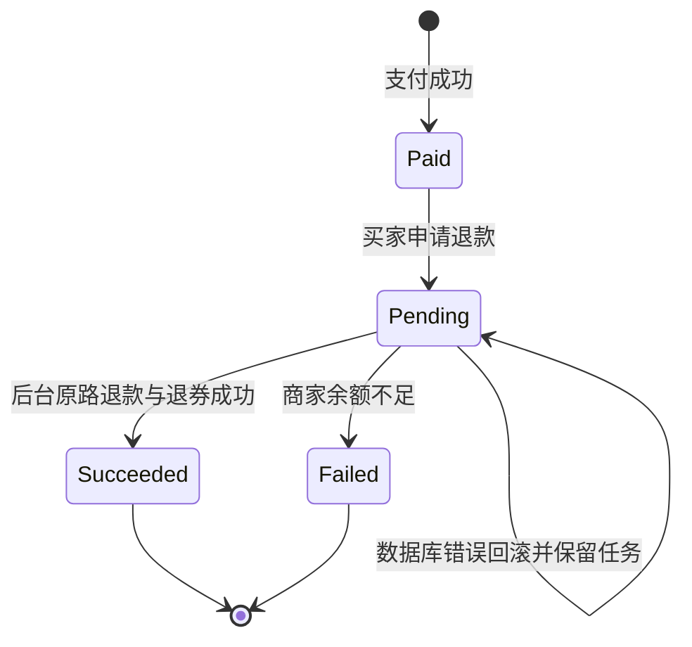
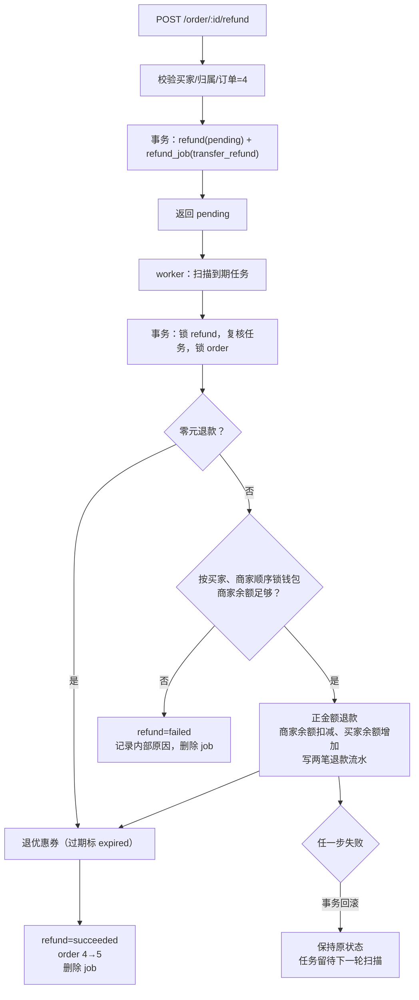

# 站内钱包全额退款设计（任务 #1）

本文定义站内钱包全额退款。业务规则见[订单退款 Spec](../requirements/order-refund.md)。

## 1. 范围

- 只处理站内钱包支付的订单：支付时已把买家余额转入商家余额；
- 只支持全额退款，金额取下单快照 `orders.payable_amount`；
- 一个订单最多一条退款，重复申请返回已有退款；
- 不做部分退款、真实外部支付渠道、平台垫资；
- 退款与退货分离：退款成功不自动返还库存，库存返还留给退货/售后流程。

## 2. 推荐方案

推荐 **方案 B：异步受理 + worker 单次转账**。

原因：

- 保持现有 `POST /order/:id/refund` 立即返回、后台处理的契约；
- 商家余额在后台检查。余额不足直接标记失败，数据库错误回滚并保留任务；
- 复用现有 `refund_jobs`、任务扫描和失败日志；
- 站内转账没有外部渠道的“结果不明”，不再需要 `query_refund`、`not_found` 和查询次数上限。

备选方案 A 见第 5 节。

## 3. 状态机

对外状态沿用现有退款枚举：

- `pending`：已受理，未执行；
- `succeeded`：退款完成，订单 `4 已支付 → 5 已退款`；
- `failed`：商家余额不足，订单保持已支付。

既有退款记录可能仍有 `processing`、`wait_retry` 和 `manual` 状态。前两者如仍有到期任务，则由站内退款执行器处理。已有终态结果保持原值。

## 4. 资金流

资金动作和退款状态必须在同一个数据库事务里：

1. 正金额退款按买家、商家顺序用 `SELECT ... FOR UPDATE` 锁住两只钱包，在持锁期间检查商家余额；
2. 余额足够时，扣减商家余额、增加买家余额，并写入两条 `wallet_logs`，幂等键包含 `refund_id`。钱包锁持有至事务结束；
3. 更新 refund / order；
4. 删除 refund_job。

任一步失败整体回滚，不允许“买家已到账、退款状态没变”或反向情况。

## 5. 两种方案对比

| 维度 | A：同步退款 | B：异步 worker（推荐） |
|---|---|---|
| 入口行为 | 申请时立即转账 | 先受理，worker 转账 |
| 一致性 | 强，HTTP 成功即退款完成 | 最终一致，状态可查询 |
| 商家余额不足 | 直接拒绝申请 | 后台标记 `failed` |
| 对现有代码 | 基本废弃 worker/mock 渠道 | 复用 worker 和任务表，新退款使用站内转账任务 |
| 接口契约 | 需要改返回语义 | 保持 pending 契约 |
| 失败补偿 | 依赖请求重试 | 数据库错误回滚并保留任务 |
| 适用 | 余额一定充足、要求即时到账 | 商家余额可能不足、需要异步处理 |

选择 B。若业务要求“申请即到账”，再单独评估 A；不能同时保留两套语义。

## 6. 业务规则

### 6.1 可退款状态

- 只允许 `orders.status = 4 已支付`；
- `5 已退款`：返回已有退款，幂等；
- 其他状态（处理中、已关闭、已完成等）返回不可退款；
- 退款金额固定为 `payable_amount`，不重新读商品价格。

### 6.2 商家余额不足

- worker 锁定钱包后检查商家余额，余额足够才扣款；
- 余额不足时不加买家余额、不写成功流水、不改订单状态；
- 后台直接将退款标记为 `failed`，结束该任务。重复申请返回已有退款；
- **不允许**把商家余额扣成负数，也**不允许**平台自动垫资（本期不做）。

### 6.3 零元订单

- `payable_amount = 0` 时双方余额保持原值，保留退款记录并更新订单状态，不写入 `wallet_logs`；
- 退款仍走状态机：`pending → succeeded`；
- 优惠券按 6.5 处理；
- 订单正常 `4 → 5`。

### 6.4 库存

- 退款成功不返还库存；
- 只有明确的“退货入库”流程才返还库存；
- 本期不把退款和库存返还绑在一起。

### 6.5 优惠券

- 券仍由当前订单占用：退回，未过期 `unused`，已过期 `expired`；
- 券已被其他订单使用或已经退回：按现有退券规则保留该券当前状态；
- 零元订单使用券的，也按同一规则退回。

### 6.6 重复/并发

- `refunds.order_id` 唯一；
- 并发申请只有一个事务插入成功，另一个返回已有退款；
- 转账与退券以 refund 行为幂等锚点，重复任务不得重复加钱/退券。

### 6.7 Timeline 状态展示

订单详情已有 `timeline` 字段，但它当前是**按当前数据实时拼装的快照**，不是 append-only 事件表：

- 有退款时固定追加 `refund_requested`；
- 再根据退款当前状态追加一个事件；
- 不保留历史重试记录。

买家侧使用以下状态映射：

| refund.status | timeline event | 含义 |
|---|---|---|
| `pending` / `processing` / `wait_retry` | `refund_processing` | 退款处理中 |
| `manual` | `refund_manual` | 需要人工处理 |
| `failed` | `refund_failed` | 终态失败 |
| `succeeded` | `refund_succeeded` | 退款成功 |

内部保留余额不足、重试耗尽和数据异常等原因供排查。买家可见的时间线和 `reason` 使用通用退款提示，最终失败时订单详情的 `refund.failure_reason` 返回「本次退款未完成」。商家余额和余额不足原因仅在内部使用。

时间线展示当前退款状态。完整的重试历史留待独立设计。

## 7. 边界例子

| # | 场景 | 期望 |
|---|---|---|
| 1 | 订单 100 元，商家余额 100 | 商家 0，买家 +100，refund=succeeded，order=5 |
| 2 | 订单 100 元，商家余额 30 | refund=failed，双方余额不变，订单仍为已支付；买家看到「本次退款未完成」 |
| 3 | 写入退款流水失败 | 余额和状态回滚，任务保留供后续扫描 |
| 4 | 零元订单（券全额抵扣） | 双方余额不变，不写钱包流水，refund=succeeded，券按规则退回/过期 |
| 5 | 同一订单并发两次申请 | 只有一条 refund、一次转账、一次退券 |
| 6 | 已退款订单再次申请 | 返回已有退款，不重复转账 |
| 7 | 商家钱包记录缺失 | 本次事务回滚，保留待执行任务和内部排查信息 |
| 8 | 退款时券已过期 | 券标 expired，不回到 unused |
| 9 | 退款时券已被其他订单使用 | 保留该券当前状态 |
| 10 | 退款成功后库存 | 不返还；由退货流程处理 |

## 8. 任务类型与旧记录

- 新申请使用 `transfer_refund`，由同一数据库事务完成资金与退款状态更新。
- 已入队的 `create_refund` 和 `query_refund` 到期后使用同一站内退款执行器。退款行锁下复核终态和任务到期时间，已结束的退款不再动账。
- 正金额退款流水的幂等键为 `order:refund:<refund_id>:debit` 和 `order:refund:<refund_id>:credit`。
