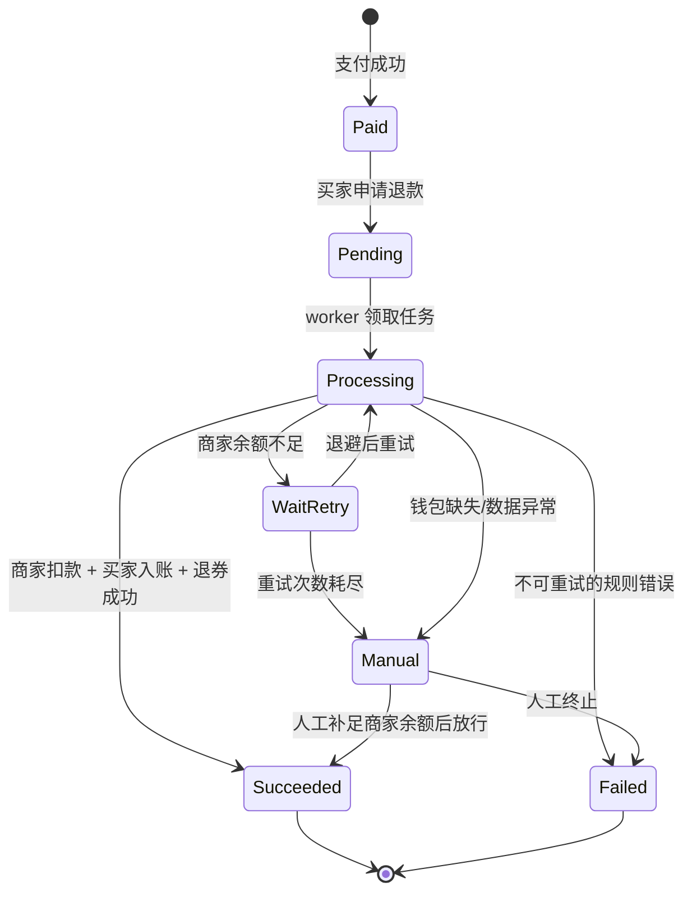
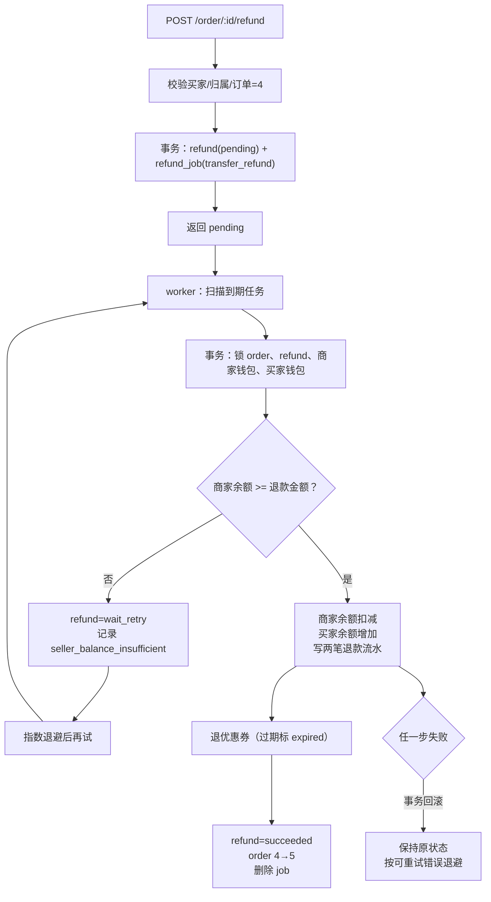

# 站内钱包全额退款设计（任务 #1）

状态：设计稿，待评审。本文只定义规则与方案，不代表已实现。

## 1. 范围

- 只处理站内钱包支付的订单：支付时已把买家余额转入商家余额；
- 只支持全额退款，金额取下单快照 `orders.payable_amount`；
- 一个订单最多一条退款，重复申请返回已有退款；
- 不做部分退款、真实外部支付渠道、平台垫资；
- 退款与退货分离：退款成功不自动返还库存，库存返还留给退货/售后流程。

## 2. 推荐方案

推荐 **方案 B：异步受理 + worker 单次转账**。

原因：

- 保持现有 `POST /order/:id/refund` 立即返回、后台处理的契约；
- 商家余额可能已被提现或消费，异步 worker 可以区分“暂时不足”和“数据异常”；
- 复用现有 `refund_jobs`、重试、`manual` 状态和监控思路；
- 站内转账没有外部渠道的“结果不明”，不再需要 `query_refund`、`not_found` 和查询次数上限。

备选方案 A 见第 5 节。

## 3. 状态机

对外状态沿用现有退款枚举：

- `pending`：已受理，未执行；
- `processing`：worker 已领取；
- `wait_retry`：商家余额不足，等待重试；
- `succeeded`：退款完成，订单 `4 已支付 → 5 已退款`；
- `failed`：不可重试的规则失败；
- `manual`：需要人工处理。

## 4. 资金流

资金动作和退款状态必须在同一个数据库事务里：

1. 条件扣商家余额：`WHERE balance >= amount`；
2. 加买家余额；
3. 写商家扣款、买家入账两条 `wallet_logs`，幂等键包含 `refund_id`；
4. 更新 refund / order；
5. 删除 refund_job。

任一步失败整体回滚，不允许“买家已到账、退款状态没变”或反向情况。

## 5. 两种方案对比

| 维度 | A：同步退款 | B：异步 worker（推荐） |
|---|---|---|
| 入口行为 | 申请时立即转账 | 先受理，worker 转账 |
| 一致性 | 强，HTTP 成功即退款完成 | 最终一致，状态可查询 |
| 商家余额不足 | 直接拒绝申请 | wait_retry，必要时 manual |
| 对现有代码 | 基本废弃 worker/mock 渠道 | 复用 worker 和任务表，删除 query/mock 渠道 |
| 接口契约 | 需要改返回语义 | 保持 pending 契约 |
| 失败补偿 | 依赖请求重试 | 任务重试 + manual |
| 适用 | 余额一定充足、要求即时到账 | 商家余额可能不足、需要异步处理 |

选择 B。若业务要求“申请即到账”，再单独评估 A；不能同时保留两套语义。

## 6. 业务规则

### 6.1 可退款状态

- 只允许 `orders.status = 4 已支付`；
- `5 已退款`：返回已有退款，幂等；
- 其他状态（处理中、已关闭、已完成等）返回不可退款；
- 退款金额固定为 `payable_amount`，不重新读商品价格。

### 6.2 商家余额不足

- worker 用条件更新扣商家余额；
- 余额不足时不加买家余额、不写成功流水、不改订单状态；
- refund 进入 `wait_retry`，指数退避重试；
- 超过重试上限进入 `manual`，等待人工补足或平台决策；
- **不允许**把商家余额扣成负数，也**不允许**平台自动垫资（本期不做）。

### 6.3 零元订单

- `payable_amount = 0` 时跳过钱包转账和资金流水；
- 退款仍走状态机：`pending → succeeded`；
- 优惠券按 6.5 处理；
- 订单正常 `4 → 5`。

### 6.4 库存

- 退款成功不返还库存；
- 只有明确的“退货入库”流程才返还库存；
- 本期不把退款和库存返还绑在一起。

### 6.5 优惠券

- 券仍由当前订单占用：退回，未过期 `unused`，已过期 `expired`；
- 券已被其他订单使用或已经退回：不覆盖，记录并转 `manual` 或按数据异常处理；
- 零元订单使用券的，也按同一规则退回。

### 6.6 重复/并发

- `refunds.order_id` 唯一；
- 并发申请只有一个事务插入成功，另一个返回已有退款；
- 转账与退券以 refund 行为幂等锚点，重复任务不得重复加钱/退券。

### 6.7 Timeline 状态展示

订单详情已有 `timeline` 字段，但它当前是**按当前数据实时拼装的快照**，不是 append-only 事件表：

- 有退款时固定追加 `refund_requested`；
- 再根据退款当前状态追加一个事件；
- 不保留历史重试记录。

当前代码把 `wait_retry` 映射成 `refund_processing`，用户看到的是“退款处理中”，而不是“退款执行异常、等待重试”。这不符合“异常要在 timeline 上可见”的要求。

建议映射：

| refund.status | timeline event | 含义 |
|---|---|---|
| `pending` / `processing` | `refund_processing` | 正常处理中 |
| `wait_retry` | `refund_wait_retry` | 执行异常，退避后重试 |
| `manual` | `refund_manual` | 需要人工处理 |
| `failed` | `refund_failed` | 终态失败 |
| `succeeded` | `refund_succeeded` | 退款成功 |

异常事件建议带可选 `reason`：

- `wait_retry`：`商家余额不足，等待重试` / `钱包服务暂时失败`；
- `manual`：`商家余额不足且重试耗尽` / `退款数据异常`；
- `failed`：可展示的失败原因，不能暴露 SQL/内部错误。

本期只展示“当前异常状态 + 最近原因”，不做每一次重试的完整历史；如果以后要展示完整链路，需要新增 `refund_events` 事件表，而不是继续从当前状态反推。

## 7. 边界例子

| # | 场景 | 期望 |
|---|---|---|
| 1 | 订单 100 元，商家余额 100 | 商家 0，买家 +100，refund=succeeded，order=5 |
| 2 | 订单 100 元，商家余额 30 | refund=wait_retry，两方余额不变；timeline 显示 `refund_wait_retry` |
| 3 | 商家余额不足且重试耗尽 | refund=manual；timeline 显示 `refund_manual`，等待人工补足/平台决策 |
| 4 | 零元订单（券全额抵扣） | 无资金流水，refund=succeeded，券按规则退回/过期 |
| 5 | 同一订单并发两次申请 | 只有一条 refund、一次转账、一次退券 |
| 6 | 已退款订单再次申请 | 返回已有退款，不重复转账 |
| 7 | 商家钱包记录缺失 | refund=manual，不扣买家、不写半套流水 |
| 8 | 退款时券已过期 | 券标 expired，不回到 unused |
| 9 | 退款时券已被其他订单使用 | 不覆盖该券，记录异常并转 manual |
| 10 | 退款成功后库存 | 不返还；由退货流程处理 |

## 8. 与原模拟外部渠道需求的差异

需要变更的条款：

- 删除 `create_refund/query_refund` 双任务类型，改为 `transfer_refund`；
- 删除“渠道结果不明”“query 查无此退款”“查询次数耗尽”；
- 删除 `refund_channel` 的 mock Create/Query 语义；
- 新增“商家余额不足”这一业务分支，对应 `wait_retry/manual`；
- 退款幂等从“渠道 refund_id”转为“refund_id + 钱包流水幂等键”；
- 状态图增加 `wait_retry/manual` 的资金原因，但不再有渠道超时原因；
- 对账从“渠道状态 vs 本地状态”改为“商家扣款 + 买家入账 + refund 状态”三方一致。

## 9. 待评审问题

1. 商家余额不足时，产品是否接受“买家等待 + manual”，还是要求平台垫资？
2. 是否允许商家负余额？本文选择不允许。
3. 库存返还策略是否确认“退款不返库存”？
4. 零元退款是否要写 0 元流水作为审计标记？
5. 方案 B 是否保留现有 `pending` 接口契约？
